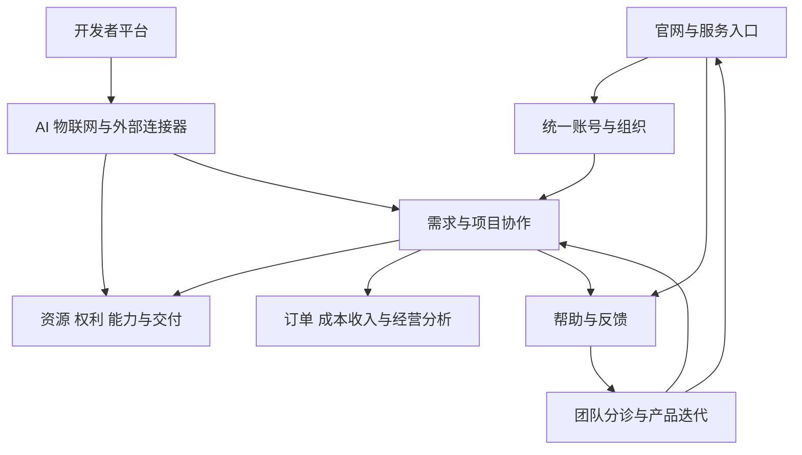

# CIAOMIND 网站、反馈与开放协作平台建设蓝图

版本为 2026-11-19 v1。依据为用户确认的 [产品指针](PRODUCT_DIRECTION.md)。持续任务见 [网站 #6](https://github.com/utopia013-droid/ciaomind-website/issues/6)。

本文件提出目标结构和实施路径。现有能力见当前基线，其余内容用于后续设计、开发与验收。

## 产品定位

以项目为共同协作单位，连接人、组织、文化与 IP 资源、设计、生产、品牌、渠道、专业服务和资本合作。

文化与 IP 保护 → AI／物联网支持的数字化 → 设计与精益制造 → 品牌与市场 → 运营及财务 → 扩张与资本合作 → 循环再投入。

平台帮助区域文化、品牌、供应链与产业参与方进入更广阔市场。欧洲企业设立作为优先服务入口，衔接市场进入、组织准备与专业执行。

## 当前基线

截至本次核对，公开官网发布代码为 bc2edd0，GitHub 已同步至产品指针分支，PR #7 待审核。

- 公开页面已有八种语言、六阶段价值链、AI 与物联网说明、12 条外部案例选片及对应咨询主题。
- 联系页会打开访客的邮件应用，由访客确认发送。
- Business OS 的现有模型包含组织成员、项目成员、项目、任务、业务证据、审核与审计。现有角色为 owner、manager、contributor、viewer。
- 2026-11-19 公开需求页实测显示禁用的输入区域。开放在线需求接收需要完成配置及端到端验收。
- Business OS 当前实现中文、意大利文和英文，其余语言使用英文回退。公开官网八语与工作台语言覆盖分别记录。
- 客户反馈工单、跨组织共享流程、开发者应用与公开接口目录列入后续建设范围。

## 网站信息结构

| 访问区域 | 页面与操作 | 对用户的作用 |
| --- | --- | --- |
| 首页 | 欧洲企业设立、文化与产业协同、描述需求、发起项目、提供资源、查看案例 | 找到适合自己的路径与下一步 |
| 服务与解决方案 | 按目标介绍输入材料、步骤、交付、费用构成和适用范围 | 评估如何合作与需要准备什么 |
| 案例与资源 | 视频、方法、可公开项目、区域资源与合作指南 | 理解做法、证据与可能的连接 |
| 合作网络 | 组织与能力介绍、服务区域、工艺与产能、申请加入 | 找到具备相应能力的参与方 |
| 我的项目 | 当前任务、资料、进度、消息、确认、交付与反馈 | 客户和合作方管理自己的工作 |
| 团队工作台 | 需求分诊、项目协调、伙伴管理、反馈、经营与审核 | 团队推进真实业务 |
| 开发者与共建 | 文档、示例、测试环境、应用、连接器和贡献指南 | 外部团队参与平台能力建设 |
| 帮助与反馈 | 当前页面求助、我的工单、服务反馈、权利问题、状态通知 | 在遇到困难的位置获得支持 |

保持一个账号，允许同一人属于多个组织、参与多个项目并承担不同角色。按当前组织、项目和权限展示操作。

保留现有 /account 与 /business-os 的实现入口，逐步在界面中使用“我的项目”“团队工作台”等易理解的名称。迁移时维护已有链接和会话行为。

每个服务页提供明确的输入、步骤、交付、费用构成、当前服务方式与行动入口。具体价格和专业条件经业务核验后发布。

## 网络参与方

| 参与方 | 提供或需要的要素 | 工作空间重点 |
| --- | --- | --- |
| 需求方与客户 | 目标、用途、预算范围、区域与交付要求 | 我的需求、方案、任务、确认、订单、交付和反馈 |
| 文化机构、社区与权利持有者 | 文化资源、来源、授权和保护要求 | 资源档案、使用范围、授权申请、内容审核与收益记录 |
| 区域品牌与市场运营方 | 品牌定位、客户、渠道和经营目标 | 产品方案、营销内容、市场反馈与项目经营分析 |
| 设计师、研究者与数字化团队 | 设计、研究、采集、建模和数字内容 | 简报、版本、批注、样品、许可与交付 |
| 工匠、制造商与物流伙伴 | 工艺、产能、材料、质量与履约 | 报价、规格、排产、质检、物流和变更确认 |
| 销售渠道与服务伙伴 | 客户触达、分销、售后与需求信号 | 渠道资料、区域反馈、售后、合作交接和结算依据 |
| 区域机构、园区与产业组织 | 地域资源、产业关系和支持服务 | 区域目录、联合项目、供需匹配和有依据的成果汇总 |
| 会计、法律、银行及资本合作方 | 专业服务、经营核验与项目评估 | 按授权提供的资料、核查事项、专业意见和服务进度 |
| 开发者与技术供应商 | 应用、数据连接器、AI、设备和工作流 | 文档、测试、应用权限、版本、调用记录和技术支持 |
| CIAOMIND 团队 | 需求理解、组织协调与平台运营 | 分诊、项目、权限、审核、反馈、运营和产品改进 |

能力目录记录来源、更新时间和核验状态。服务类别与组织成员权限分别建模。注册身份、项目参与资格、文化资源使用权和资金审批各有明确记录。

## 客户与项目路径

发现服务 → 描述目标 → 保存需求并获得编号 → 团队分诊 → 确认范围与授权 → 组织项目伙伴 → 方案及报价 → 里程碑执行 → 交付确认 → 经营记录 → 反馈与后续合作。

访客可先浏览和描述需求。账号在保存、查看、编辑或协作时发挥作用。材料按业务阶段补充，避免在尚未明确用途时收集过多资料。

项目内显示目前状态、下一步、责任人、所需输入和交付要求。跨组织参与方通过项目邀请和明确的数据授权加入。文档更新、规格变更、样品与报价使用版本和确认记录。

区域资源匹配依据权利、能力、工艺、产能、地区、交期、质量、市场需求和项目条件。推荐结果说明匹配依据，由参与方确认合作与实际交付。

## 反馈系统

### 反馈入口与类型

- 页面帮助和功能建议，可带上页面、语言、浏览器版本及用户主动提供的描述。
- 服务咨询和操作困难，进入支持队列并关联客户。
- 项目问题、变更和争议，关联项目、任务、里程碑和当前责任人。
- 交付后的满意度与改进意见，关联具体交付。
- 文化内容、来源、授权及保护问题，进入专门的核验流程。
- 合作伙伴和开发者的接入问题，关联服务、应用或接口版本。

反馈附带必要上下文，附件和诊断信息按用户选择及访问权限处理。匿名访客可提交一般问题，涉及具体项目资料的操作使用相应身份与权限。

### 处理闭环

提交成功 → 获得工单编号与查看入口 → 分类和确认责任人 → 处理及进度通知 → 提供解决结果 → 用户确认或重新打开 → 复盘改进。

表单成功提示以服务端保存结果为依据。重复提交使用幂等标识处理，发送通知失败可重试。处理期限由实际排班和服务安排确定，并在工单中说明。

平台反馈分别关联业务工单和产品改进任务。工程任务采用必要、经过整理的技术信息，并保留回到业务工单的权限控制。

### 反馈如何驱动建设

每项改进记录目标用户、具体阻塞、影响范围、频次、所属价值链环节、负责人、拟议改进、实际验证和上线结果。

优先考虑阻碍需求提交、权限与资料访问、伙伴交接和交付确认的问题。逐步建立入口成功率、需求完成率、交接等待时间、响应与解决时间、重开率、返工、满意度、重复合作和项目经济性的实测基线。

收集反馈、作出服务处理决定、选择产品优先级和对外发布评价分别由相应责任人负责。公开案例与评价按确认的分享范围展示。

## 实现结构

初期沿用 Next.js、现有账号体系和 Supabase，组织为同一产品内边界清楚的业务模块。根据实际负载和部署需要逐步扩展独立服务。

- 访问层采用统一身份与组织、项目、资源授权，沿用数据库行级权限和审计。
- 服务层划分需求、资源与权利、项目协作、伙伴能力、交易与经营、反馈、通知与集成。
- 数据层逐步补齐反馈工单、消息、项目参与方、资源授权、应用、连接器和事件。
- 文档与媒体关联所属组织和项目，以明确授权和有效期提供访问。
- 工作流将保存、通知和异步集成分开处理，记录任务状态、失败和重试，避免重复副作用。
- 运营日志与产品指标记录必要信息，并通过错误、指标和追踪支持排障。

跨组织协作沿现有组织隔离基础扩展项目参与与资源授权，验证邀请、访问、交付和退出。不同主体的账务、合同、权利和资产归属分别记录，通过共同的经营口径进行项目管理分析。

技术参考采用 [Supabase 行级权限](https://supabase.com/docs/guides/database/postgres/row-level-security)、[OpenTelemetry](https://opentelemetry.io/docs/concepts/observability-primer/) 与 [WCAG 2.2](https://www.w3.org/TR/WCAG22/)。

## 可以形成自己的开发者平台

围绕真实项目产生的可复用能力，逐步形成 CIAOMIND 开发者与共建平台。

外部参与包括文化数据提供方、AI 应用开发者、设备与物联网供应商、设计制造软件集成方、ERP 与财务工具开发者、区域运营团队、内容及翻译贡献者。

### 开放能力

- 开发者或组织申请、身份与应用登记、团队成员。
- API 文档、接口示例、测试数据、测试环境与版本记录。
- 按组织、项目、资源和用途授予的应用权限，包含有效期、撤销、限额和使用记录。
- 公共且已授权的资源元数据查询、需求提交、项目事件订阅和交付提交等分阶段接口。
- 连接器目录、工作流模板、组件贡献、问题反馈与审核发布。
- 数据提供者的许可说明与使用范围，贡献者的署名、维护责任和项目合作约定。
- 成熟后基于实际服务和合作合同评估商业分发、服务费或分成。

从少量受邀合作方和一个完整接入案例开始，验证开发者能读文档、使用测试数据、提交集成、获得反馈并完成一项实际交付。

### 接口与治理

HTTP 接口可用 [OpenAPI](https://spec.openapis.org/oas/latest.html) 描述资源、权限、请求、响应、错误和版本。项目事件可参考 [CloudEvents](https://cloudevents.io/) 的一致事件格式。

应用访问与个人访问分别记录。接口与 Webhook 提供签名核验、重试、幂等、限额和审计。测试数据与生产项目按环境授权。发布、升级、停止服务和安全问题有明确处理流程。

初期开发者门户可在现有网站上建设文档、示例和应用页面。组织内部的软件目录在规模扩大时可参考 [Backstage](https://backstage.io/docs/overview/what-is-backstage/) 的能力。

## 分阶段实施与验收

| 阶段 | 交付 | 进入下一阶段的依据 |
| --- | --- | --- |
| 一 服务与反馈闭环 | 角色与目标入口、账号恢复与验证、服务端需求编号、团队分诊、工单与状态通知 | 真实用户可保存需求、获得编号，团队可接收处理，用户可查看结果和反馈 |
| 二 项目协作闭环 | 项目参与方邀请、资源与权限、任务、里程碑、版本、交付和确认 | 一个获授权项目能完成跨组织协作、交付与反馈，访问及退出行为经过核验 |
| 三 区域网络与可复制运营 | 有依据的伙伴目录、区域供需、经营口径、一个 AI 或物联网连接试点、过程复盘 | 能说明匹配、履约、技术效果与经营结果，并找到可复用环节 |
| 四 开发者内测与共建 | 文档、应用、权限、测试环境、接口、事件、连接器贡献和支持 | 外部合作方能够独立接入并完成可核查的贡献，调用与支持过程可运营 |

各阶段以验收结果推进，具体工期和费用根据团队能力、第三方接入与实际工作量确认。

当前优先项为服务端需求接收、客户反馈工单和团队接单处理。先让一个真实项目走通用户进入、伙伴协作、交付与改进，再从重复工作中提炼平台能力。

## 交付协作

网站 #6 保持总体产品任务入口，网站 PR #7 保存代码与蓝图。Muse 在调度台 #67 回读愿景、建设蓝图和当前实现状态，按目标用户、阻塞、责任方、交付物与验收证据协调每轮工作。

任务记录区分规划、实现、实测、发布与运营结果。每轮更新说明用户体验和协作结果实际改善了什么，并列出尚待验证的事项。
